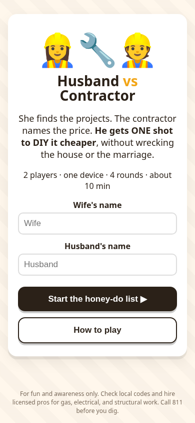
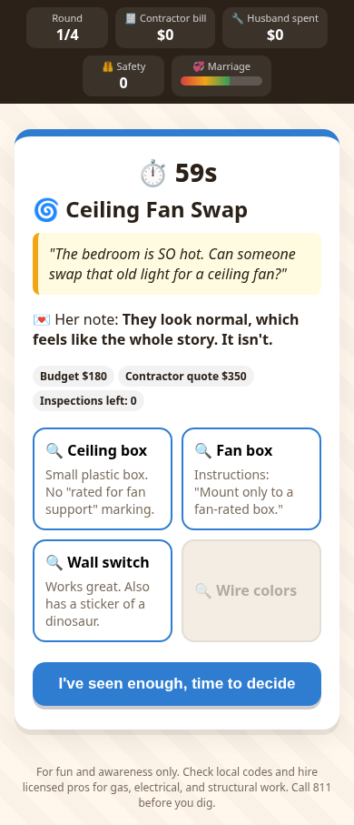
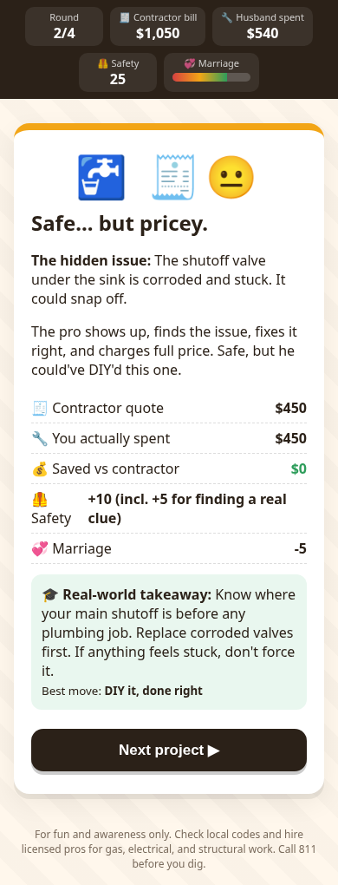

#Project for Handshake Deployment
# Husband vs Contractor 🔧

A 2-player, pass-the-device browser game. She finds the house projects. The contractor names the price. **He gets ONE shot to DIY it cheaper**, without wrecking the house or the marriage.

Every "simple" job hides an everyday homeowner surprise: a leak behind the drywall, a grill that needs a natural gas line, a rotted water heater platform, a ceiling box that isn't rated for a fan, and more. The game teaches when to DIY and when to call a pro.

▶ **Play:** https://tylerkat89.github.io/husband-vs-contractor/

## How to play
1. **Wife:** pick a project, set the DIY budget and the "Call the Pro" timer, then leave a note. You see one secret clue, and you can share it, hint at it, keep quiet, or bluff.
2. **Pass the device.**
3. **Husband:** inspect up to 3 spots before the timer runs out, then call the pro, or take your ONE shot and work the job **step by step in the right order** (shutoffs first!). Each step has 3–4 options. Wrong moves cost money, time, and marriage points, and dangerous ones end the job. Some jobs end correctly with "call a pro" after you diagnose the problem, and your diagnosis cuts the bill.
4. **Recap:** see the hidden issue, the costs, the correct step order next to your picks, and the real-world lesson.
5. After 4 rounds, the husband wins if he spent less than the contractor's total bill **with zero unsafe attempts**. You also get scores for 🦺 Safety and the 💞 Marriage Meter, plus a final title.

No install. Runs in any modern browser (mobile-friendly). Plain HTML/CSS/JS. Scenarios live in `js/scenarios.js`.

## Screenshots
  

## Safety disclaimer
For fun and awareness only. This is not professional advice. Check local codes, and hire licensed pros for gas, electrical, and structural work. Get permits where required. Call 811 before you dig. If you smell gas, leave and call 911 or your gas company.

Built by Tyler Katayama (former HVAC tech) for the Handshake AI Skills Studio multiplayer game challenge, October 2026.
